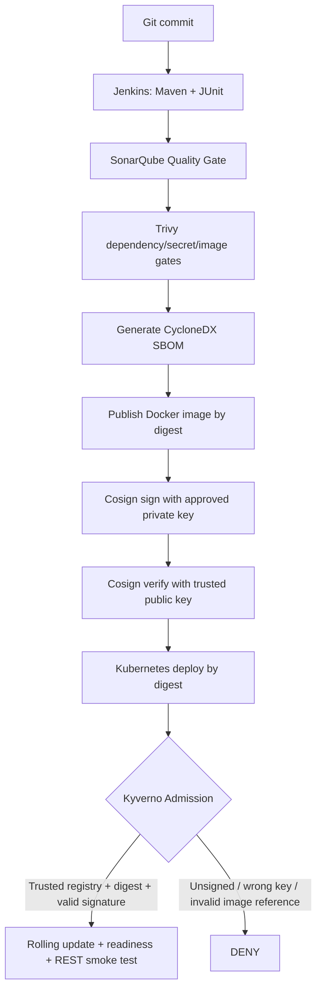

# BANKING CI/CD LAB — CD-02: Software Supply Chain Security & Kubernetes Admission

> **Phiên bản:** 1.0 · **Ngày tổng hợp:** 21/11/2026  
> **Tài liệu tiếp nối:** `docs/banking-cicd-runbook-ci01-cd01.md`  
> **Phạm vi:** CI/CD security enhancements (SBOM, release evidence, Cosign image signing), Kyverno ImageValidatingPolicy, admission negative tests và Jenkins end-to-end regression.  
> **Trạng thái:** **CD-02.3 CLOSED / PASS** trong phạm vi local lab, xác nhận bằng Jenkins build #39 và Kubernetes Deployment revision 23. **CD-02.4 chưa triển khai.**  
> **Đối tượng:** Backend Developer, DevOps, Platform Engineer, Tech Lead, Solution Architect (Banking/Fintech).

---

## Mục lục

1. [Mục đích, phạm vi và kết quả](#1-mục-đích-phạm-vi-và-kết-quả)
2. [Kiến trúc và inventory của lab](#2-kiến-trúc-và-inventory-của-lab)
3. [Hành trình triển khai và checkpoints](#3-hành-trình-triển-khai-và-checkpoints)
4. [Cosign signing, verification và signature storage](#4-cosign-signing-verification-và-signature-storage)
5. [Kyverno Policies — Registry, Digest, Signature](#5-kyverno-policies--registry-digest-signature)
6. [Troubleshooting — những lỗi thực tế và root cause](#6-troubleshooting--những-lỗi-thực-tế-và-root-cause)
7. [CD-02.3F — Admission Security Testing](#7-cd-023f--admission-security-testing)
8. [CD-02.3G — Jenkins End-to-End Regression](#8-cd-023g--jenkins-end-to-end-regression)
9. [Evidence, acceptance criteria và trạng thái cuối](#9-evidence-acceptance-criteria-và-trạng-thái-cuối)
10. [Checklist tái hiện và khôi phục lab](#10-checklist-tái-hiện-và-khôi-phục-lab)
11. [Giới hạn và backlog hardening](#11-giới-hạn-và-backlog-hardening)
12. [Hướng tiếp theo: CD-02.4](#12-hướng-tiếp-theo-cd-024)

---

## 1. Mục đích, phạm vi và kết quả

### 1.1. Bài toán

Sau khi hoàn thành CI01–CD01, pipeline đã build, scan, publish và deploy Spring Boot Banking API vào Kubernetes. CD-02 bổ sung **software supply chain controls** nhằm bảo đảm rằng image triển khai:

- Đến từ registry được tin cậy (`ci-registry-1:5000`).
- Được tham chiếu bằng immutable digest (`@sha256:...`) thay vì tag có thể thay đổi.
- Có chữ ký Cosign xác minh bằng public key đáng tin cậy.
- Bị Kubernetes Admission từ chối nếu không có chữ ký hoặc sử dụng sai signing key, kể cả khi thao tác deploy không đi qua Jenkins.
- Có Jenkins evidence về build, kiểm thử, quality/security gates, SBOM, release digest, signing, verification và rollout.

### 1.2. Kết quả đã xác minh

| Nhóm | Kết quả | Bằng chứng |
|---|---|---|
| Cosign signing/verify | PASS | Key-based signature; signing/verification trong Jenkins #39 |
| Trusted registry policy | PASS với workload hiện tại | PolicyReport: current Deployment/ReplicaSet/Pods 3 PASS, 0 FAIL (trước build #39) |
| Immutable digest policy | PASS với workload hiện tại | Image reference chứa `@sha256:` |
| Image signature policy | PASS | ImageValidatingPolicy, signed ALLOW; unsigned/wrong-key DENY |
| Admission negative testing | **4/4 PASS** | CP-F01–F04 |
| Jenkins end-to-end | **PASS** | Build `ci-39`, `Finished: SUCCESS` |
| K8s rollout | **PASS** | Deployment revision 23; 2/2 Ready, Updated, Available |
| CD-02.4 provenance attestation | **NOT STARTED** | Đề xuất triển khai tiếp |

> **Giới hạn evidence:** PolicyReport 3/0 cho workload hiện tại được chụp **trước** Jenkins #39. Deployment revision 23 được xác minh 2/2 Ready và Jenkins rollout PASS; chưa có PolicyReport mới được cung cấp ngay sau build #39. Không diễn giải snapshot trước đó thành bằng chứng policy-report cho revision 23.

---

## 2. Kiến trúc và inventory của lab

| Thành phần | Giá trị đã sử dụng |
|---|---|
| Host | Windows 11 / PowerShell / Docker Desktop Kubernetes (kind) |
| Jenkins job | `banking-api-ci` |
| Jenkins Docker agent | `ci-docker-agent-1` |
| Registry | `ci-registry-1:5000` (HTTP local lab) |
| Docker network | `banking-cicd-net` |
| Namespace | `banking-dev` |
| Deployment | `banking-api` (2 replicas) |
| Kubernetes node | `desktop-control-plane` |
| Kyverno | v1.20, Admission/Background/Cleanup/Reports controllers |
| Cosign | v3.1.4 (agent) |
| Image signing mode confirmed compatible | Legacy Cosign signature tag (`sha256-<digest>.sig`) |
| Java / Maven / Spring Boot | Java 21 / Maven 3.10.0 / Spring Boot 4.1.2 trong Jenkins #39 |
| Trivy | v0.76.2 trong Jenkins #39 |
| Source repository | `https://github.com/thinhhong1973/banking-cicd-lab.git` |
| Branch | `lab/trivy-04-remediation` |
| Release commit | `29cd50e395fe9ab36df1e8a6b2808ea7031cc47a` |

### 2.1. Luồng triển khai và bảo vệ



**Điểm phân biệt:** Jenkins thực hiện security gates trong pipeline; Kyverno thực thi security policies độc lập tại Kubernetes Admission, chặn cả thao tác trực tiếp bằng `kubectl`.

---

## 3. Hành trình triển khai và checkpoints

| Checkpoint | Nội dung | Trạng thái cuối |
|---|---|---|
| CD-02.3A | Cài Kyverno v1.20 (4 controllers) | PASS |
| CD-02.3B | Xác minh Kyverno kết nối local Registry | PASS |
| CD-02.3C | `ValidatingPolicy` — Trusted Registry | PASS |
| CD-02.3D | `ValidatingPolicy` — Immutable SHA256 Digest | PASS |
| CD-02.3E | `ImageValidatingPolicy` — Cosign Signature | PASS sau sửa verifier và storage compatibility |
| CD-02.3F | Admission tests: signed, unsigned, wrong-key, bypass | **4/4 PASS** |
| CD-02.3G | Jenkins automated signing, verify, deploy and smoke test | PASS — build #39 |
| CD-02.3H | Deployment và compliance evidence | PASS với giới hạn snapshot nêu ở §1.2 |

### 3.1. Kyverno API version

Kyverno v1.20 tại lab không dùng cấu hình policy legacy `kyverno.io/v1 ClusterPolicy` cho luồng triển khai này. Các resource được sử dụng:

- `policies.kyverno.io/v1` — `ValidatingPolicy` để kiểm tra trusted registry và digest.
- `policies.kyverno.io/v1` — `ImageValidatingPolicy` để xác minh chữ ký image.

**Policy names trong lab:** `require-trusted-registry`, policy kiểm tra immutable digest (xem tên thực tế bằng `kubectl get validatingpolicies`) và `require-banking-image-signature`.

### 3.2. Phạm vi bảo vệ

Signature policy match Pod trong namespace `banking-dev` và sử dụng autogen cho `deployments`, `replicasets`, `statefulsets`, `daemonsets`, `jobs`, `cronjobs`. Kết quả CP-F04 xác minh thao tác cập nhật Deployment trực tiếp bị chặn.

---

## 4. Cosign signing, verification và signature storage

### 4.1. Tạo và bảo quản khóa

- Cosign sử dụng key pair: private key `cosign.key`, public key `cosign.pub`.
- Trong lab, public key tin cậy đã được đưa vào `ImageValidatingPolicy.spec.attestors[].cosign.key.data` dưới dạng PEM.
- Private key/password được Jenkins nạp qua Credentials, không đưa vào Git.
- Key pair `negative-test` riêng được dùng để kiểm tra sai signing identity.

### 4.2. Hai cơ chế storage đã quan sát

**Cosign v3 bundle (định dạng mới):** Local registry không phục vụ `/v2/banking-api/referrers/<digest>` (HTTP 404), nhưng có OCI fallback tag `sha256-<digest>`. Fallback index chứa **hai** manifests với `artifactType: application/vnd.dev.sigstore.bundle.v0.3+json`; subject của artifact tham chiếu đúng digest image. Tuy vậy Kyverno trả `no signatures found` khi chỉ có các artifact này.

**Cosign legacy format:** Sau khi ký cùng image bằng `--new-bundle-format=false --registry-referrers-mode=legacy`, registry xuất hiện tag `sha256-<digest>.sig`, và Kyverno chấp nhận signed image. Đây là **bằng chứng thực nghiệm về vấn đề tương thích signature discovery**; chưa xác định chính xác bug nội bộ của Kyverno. Không kết luận rằng bundle artifacts ban đầu thiếu `artifactType`, vì kết quả kiểm tra cho thấy thuộc tính này **có giá trị hợp lệ**.

### 4.3. Lệnh ký tương thích local lab

Chạy trong môi trường có Cosign v3.1.4 và quyền truy cập key/registry (tùy agent dùng registry name hoặc hostname phù hợp):

```bash
cosign sign \
  --key "$COSIGN_KEY_FILE" \
  --allow-http-registry \
  --tlog-upload=false \
  --use-signing-config=false \
  --new-bundle-format=false \
  --registry-referrers-mode=legacy \
  --yes \
  "$SIGN_REF"
```

> `--new-bundle-format`, `--tlog-upload` và `--use-signing-config` được Cosign v3.1.4 cảnh báo deprecated. Đây là cách tương thích **cho lab hiện tại**, không nên coi là phương án lâu dài cho production.

**Kiểm tra legacy tag (PowerShell):**

```powershell
$ref = kubectl -n banking-dev get deployment banking-api `
  -o jsonpath='{.spec.template.spec.containers[0].image}'
$digest = ($ref -split '@', 2)[1]
$sigTag = "sha256-$($digest.Substring(7)).sig"
$tags = Invoke-RestMethod 'http://localhost:5000/v2/banking-api/tags/list'
$tags.tags -contains $sigTag
```

Tag tồn tại **không thay thế** xác minh chữ ký bằng trusted key.

---

## 5. Kyverno Policies — Registry, Digest, Signature

### 5.1. Trusted Registry

Yêu cầu mọi container images thuộc phạm vi policy sử dụng `ci-registry-1:5000/`. Những ReplicaSets lịch sử dùng địa chỉ registry cũ có thể bị PolicyReport đánh FAIL.

### 5.2. Immutable Digest

Image phải có dạng `ci-registry-1:5000/banking-api@sha256:<64 hex>`. Deploy theo digest, không deploy chỉ theo tag `:ci-39`.

### 5.3. ImageValidatingPolicy — các trường thiết yếu

**Đây là fragment mang tính hướng dẫn, không phải manifest đầy đủ để apply độc lập.** Không thay thế toàn bộ policy chỉ bằng fragment này.

```yaml
apiVersion: policies.kyverno.io/v1
kind: ImageValidatingPolicy
metadata:
  name: require-banking-image-signature
spec:
  validationActions: [Deny, Audit]
  failurePolicy: Fail
  credentials:
    allowInsecureRegistry: true   # local HTTP registry only
  validationConfigurations:
    mutateDigest: false
    required: true
    verifyDigest: true
  matchImageReferences:
    - glob: 'ci-registry-1:5000/*'
  attestors:
    - name: bankingSigner
      cosign:
        key:
          data: |
            -----BEGIN PUBLIC KEY-----
            <INSERT_TRUSTED_COSIGN_PUBLIC_KEY>
            -----END PUBLIC KEY-----
        ctlog:
          insecureIgnoreTlog: true  # local lab exception
  validations:
    - expression: >-
        images.containers.map(image,
          verifyImageSignatures(image, [attestors.bankingSigner])
        ).all(count, count > 0)
      message: 'Image signature verification failed.'
```

Manifest thực tế còn có namespace selector, resource rules, các validations cho init/ephemeral containers và autogen Pod controllers. Phải giữ các phần đó khi cập nhật policy.

**Kiểm tra live policy:**

```powershell
kubectl get imagevalidatingpolicy require-banking-image-signature -o yaml
kubectl get imagevalidatingpolicy require-banking-image-signature `
  -o jsonpath='{.spec.validationActions}'

$policy = kubectl get imagevalidatingpolicy require-banking-image-signature -o json |
  ConvertFrom-Json
[bool](-not [string]::IsNullOrWhiteSpace($policy.spec.attestors[0].cosign.key.data))
```

**Cảnh báo:** Không commit manifest có `data: ""` hoặc placeholder vào Git. File `k8s/policies/03-require-image-signature.yaml` cần đồng bộ với cấu hình cluster; trước khi `kubectl apply` hãy kiểm tra live/server-side dry run. Không đưa private key vào manifest.

---

## 6. Troubleshooting — những lỗi thực tế và root cause

| ID | Triệu chứng | Nguyên nhân đã xác minh / nhận định | Cách xử lý |
|---|---|---|---|
| T01 | Kyverno báo `one of verifier, root certs, or trusted root is required` | `attestors.cosign.key.data` trên cluster **rỗng** (`data: ""`) | Khôi phục PEM public key, xác nhận key cluster khớp local |
| T02 | Sau khi sửa key, Kyverno báo `no signatures found` | Registry chứa Sigstore bundle trong fallback OCI index, nhưng Kyverno không tìm được chữ ký ở dạng đó | Ký thêm legacy format `sha256-<digest>.sig`; kiểm tra lại admission |
| T03 | `/v2/banking-api/referrers/sha256:...` trả 404 | Registry hiện tại không cung cấp OCI Referrers endpoint | Kiểm tra fallback index tag thay vì kết luận chưa ký |
| T04 | Có fallback index nhưng Kyverno vẫn FAIL | OCI index có manifests và `artifactType` hợp lệ; lỗi discovery/compatibility vẫn tồn tại | Dùng isolated compatibility test; không khẳng định `artifactType` bị thiếu |
| T05 | PowerShell `kubectl patch -p='[...]'` báo parse JSON lỗi | Quoting biến đổi khi PowerShell truyền argument cho native `kubectl.exe` | Tạo file UTF-8 không BOM và dùng `kubectl patch --patch-file` |
| T06 | Unsigned image có warning nhưng exit code `0` | Policy đang `validationActions: [Audit, Warn]` | Khi sẵn sàng kiểm thử, chuyển `Deny` qua patch file; test lại |
| T07 | PolicyReport có FAIL trên ReplicaSets cũ | Một số revisions cũ sử dụng registry hostname bị chặn | Phân biệt historical ReplicaSets với current workload; không xóa chỉ để làm đẹp số liệu |
| T08 | `ConvertTo-Json | Set-Content` dường như treo trong PowerShell | Không có bằng chứng đủ để kết luận nguyên nhân; có thể shell đang chờ cú pháp hoặc biến không như dự kiến | Ctrl+C, tách conversion/ghi file, inspect `$patch`, dùng `[IO.File]::WriteAllText()` |

### 6.1. Safe patch trên Windows PowerShell

Ví dụ chuyển policy từ Audit sang Enforce, không làm thay đổi attestor:

```powershell
$patch = @{ spec = @{ validationActions = @('Deny', 'Audit') } }
$json = ConvertTo-Json -InputObject $patch -Depth 5
$path = Join-Path $env:TEMP 'kyverno-enforce-patch.json'
[System.IO.File]::WriteAllText(
  $path, $json, [System.Text.UTF8Encoding]::new($false)
)
kubectl patch imagevalidatingpolicy require-banking-image-signature `
  --type merge --patch-file $path
if ($LASTEXITCODE -ne 0) { throw 'Policy patch failed' }
```

Sau đó kiểm tra `kubectl get imagevalidatingpolicy ... -o jsonpath='{.spec.validationActions}'` và key `data` vẫn không rỗng. **Bật Deny chỉ khi signed-image test đã PASS.**

---

## 7. CD-02.3F — Admission Security Testing

Cả bốn cases đã được chạy với `--dry-run=server`: Kubernetes Admission được gọi nhưng không tạo/đổi workload thực tế.

| ID | Test | Expected | Actual | Kết luận |
|---|---|---|---|---|
| F01 | Pod dùng signed banking-api digest và trusted key | ALLOW | YAML returned, exit code 0 | PASS |
| F02 | Pod dùng unsigned image trong approved registry | DENY | Webhook deny, `no signatures found`, exit 1 | PASS |
| F03 | Pod dùng image đã ký bằng `negative-test` key | DENY | Webhook deny, `no matching signatures: invalid signature ... ASN.1`, exit 1 | PASS |
| F04 | Direct `kubectl set image deployment/banking-api` sang unsigned image | DENY | Webhook deny, `no signatures found`, exit 1 | PASS |

**Negative fixtures:**

- `ci-registry-1:5000/admission-unsigned@sha256:2d8a11041a92082ba21e364dec73559ce44f1de69b60fa68315f6d3774e59117`
- `ci-registry-1:5000/admission-wrong-key@sha256:2d8a11041a92082ba21e364dec73559ce44f1de69b60fa68315f6d3774e59117`

Hai repositories có thể dùng cùng image content digest, nhưng **chữ ký khác nhau theo repository/identity**. Wrong-key CLI verification với `negative-test` public key đã PASS, còn Kyverno trusted signer đã DENY — chứng minh kiểm tra đúng cryptographic identity.

**Câu lệnh regression (PowerShell):**

```powershell
$signedRef = kubectl -n banking-dev get deployment banking-api `
  -o jsonpath='{.spec.template.spec.containers[0].image}'

kubectl -n banking-dev run test-signed-image `
  --image=$signedRef --restart=Never --dry-run=server -o yaml
Write-Host "Signed exit: $LASTEXITCODE"   # expected 0

$unsignedRef = 'ci-registry-1:5000/admission-unsigned@sha256:2d8a11041a92082ba21e364dec73559ce44f1de69b60fa68315f6d3774e59117'
kubectl -n banking-dev run test-unsigned-image `
  --image=$unsignedRef --restart=Never --dry-run=server -o yaml
Write-Host "Unsigned exit: $LASTEXITCODE" # expected non-zero, admission signature deny
```

CP-F04 nên dùng `kubectl -n banking-dev set image deployment/banking-api "banking-api=$unsignedRef" --dry-run=server -o yaml`; không bỏ `--dry-run=server` khi thử bypass.

---

## 8. CD-02.3G — Jenkins End-to-End Regression

### 8.1. Build #39: independent evidence

| Field | Value |
|---|---|
| Jenkins job | `banking-api-ci` |
| Docker tag | `banking-api:ci-39` |
| Git SHA | `29cd50e395fe9ab36df1e8a6b2808ea7031cc47a` |
| Old running digest | `sha256:2575ff1e6d1dedf4b5e40fae57ef2ca561ba9cd463a40f71922ab9ac86164ac4` |
| New published/deployed digest | `sha256:b4ed101da086979d98a43559aa925d5ac17849b08a7254c5d3f9b5fe6e6445c8` |
| Deployment revision | `23` (previous: 22) |
| Replicas | `2 desired / 2 updated / 2 ready / 2 available` |
| Jenkins result | `Finished: SUCCESS` |

### 8.2. Jenkins checkpoints (log đã cung cấp)

| Stage | Result |
|---|---|
| Maven `clean verify` | 2 tests; 0 failures, 0 errors, 0 skipped |
| SonarQube Analysis / Quality Gate | Analysis SUCCESS; Quality Gate `OK` |
| Trivy dependency gate | CRITICAL 0, HIGH 0 |
| Trivy secret gate | Stage continued successfully; no build-blocking finding |
| Docker image scan | CRITICAL 0, HIGH 0 |
| CycloneDX SBOM | Version 1.7, 184 components; validation PASS |
| Registry publish | `ci-39`, digest `b4ed101d...`; PASS |
| Release manifest | GENERATED |
| Cosign signing | `IMAGE SIGNING PASSED` (new digest) |
| Cosign verify | Claims and signature verified with public key |
| Kubernetes deploy | `VERIFIED RELEASE DIGEST MATCHED`; rollout success |
| REST smoke test | `REST SMOKE TEST PASSED` |
| Jenkins pipeline | `Finished: SUCCESS` |

### 8.3. Đối chiếu Docker Registry → Jenkins → Kubernetes

```
Git commit: 29cd50e395fe9ab36df1e8a6b2808ea7031cc47a
Docker tag: banking-api:ci-39
Registry image: ci-registry-1:5000/banking-api@sha256:b4ed101da086979d98a43559aa925d5ac17849b08a7254c5d3f9b5fe6e6445c8
Cosign: signing PASS + verify PASS
K8s: deployment/banking-api (revision 23) uses exact same digest
Rollout: completed successfully; 2/2 Ready
Smoke test: PASS
```

Jenkins log ghi: `Previous image: ...2575ff1e...`, `Approved image: ...b4ed101d...`, `deployment.apps/banking-api image updated`, rồi `successfully rolled out`. Deployment evidence sau build #39 xác nhận `spec.template.spec.containers[0].image` chính xác digest mới.

### 8.4. Kiểm tra trạng thái cuối (PowerShell)

```powershell
kubectl -n banking-dev rollout status deployment/banking-api --timeout=180s
kubectl -n banking-dev get deployment banking-api
kubectl -n banking-dev get pods -l app=banking-api
kubectl -n banking-dev get deployment banking-api `
  -o jsonpath='{.spec.template.spec.containers[0].image}'
kubectl -n banking-dev get policyreports
kubectl get validatingpolicies
kubectl get imagevalidatingpolicies
```

**Lưu ý:** Chạy lại `kubectl get policyreports` để lưu compliance snapshot **sau** revision 23; snapshot cũ không chứng minh trực tiếp trạng thái compliance của revision mới.

---

## 9. Evidence, acceptance criteria và trạng thái cuối

### 9.1. Danh sách evidence đã xem

1. Jenkins #39 Console Output: build/test, SonarQube, Trivy, SBOM, publish, sign, verify, deploy, smoke test, SUCCESS.
2. `deployment-evidence(2).yaml`: `revision: "23"`, image digest mới, `readyReplicas: 2`, `updatedReplicas: 2`, `availableReplicas: 2`.
3. PolicyReport screenshot/text trước build #39: current Deployment/ReplicaSet/Pods `PASS=3 FAIL=0`; các ReplicaSets cũ `PASS=2 FAIL=1`.
4. Admission negative-test output CP-F01–F04 với exit code 0/1 và webhook denial reasons.
5. OCI fallback index JSON, registry tags, Cosign CLI sign/verify output.

### 9.2. Acceptance matrix

- [x] Signed image trusted key được Kyverno ALLOW trong Enforce.
- [x] Unsigned image bị Kyverno DENY.
- [x] Wrong-key signed image bị Kyverno DENY.
- [x] Direct Deployment modification sang unsigned image bị DENY.
- [x] Jenkins build mới publish, sign và verify image mới.
- [x] Jenkins rollout chính image digest đã verify.
- [x] Kubernetes Deployment 2/2 Ready.
- [x] REST smoke test PASS.
- [x] Current workload compliance 3/0 trước release mới.
- [ ] Chụp PolicyReport mới cho Revision 23 (để hoàn thiện evidence sau-release).

---

## 10. Checklist tái hiện và khôi phục lab

### 10.1. Preflight

```powershell
docker ps --format '{{.Names}}  {{.Status}}'
kubectl get nodes
kubectl -n kyverno get pods
kubectl -n banking-dev get deployment banking-api
Invoke-RestMethod http://localhost:5000/v2/
```

### 10.2. Policy integrity

```powershell
kubectl get validatingpolicies
kubectl get imagevalidatingpolicy require-banking-image-signature -o yaml
kubectl get imagevalidatingpolicy require-banking-image-signature `
  -o jsonpath='{.spec.validationActions}'
```

Expected for signature policy: `Deny` present, attestor public key nonempty. Verify that `failurePolicy: Fail`, `verifyDigest: true`, `required: true` remain configured.

### 10.3. Jenkins build/release

- Dùng đúng source branch và Jenkinsfile đã cập nhật signature mode.
- Không xóa `ci-registry-1` volume; không xóa Cosign private key hoặc Jenkins Credentials.
- Jenkins #39 là evidence lịch sử, không phải digest cố định dùng cho mọi build.
- Mỗi release mới phải có digest reference mới hoặc evidence cho việc reuse digest; signature verification phải đạt trước deploy.
- Kiểm thử `kubectl` server dry-run trước khi thay policies.
- Sau release, lưu Jenkins console output, release manifest, SBOM, published digest, Kubernetes Deployment YAML và PolicyReport.

---

## 11. Giới hạn và backlog hardening

| Priority | Vấn đề | Hướng xử lý |
|---|---|---|
| High | Local HTTP Registry (`allowInsecureRegistry`) | TLS, authentication, network policy; private production registry |
| High | Legacy Cosign signature format (deprecated) | Registry OCI 1.1 Referrers support + kiểm thử Kyverno bundle discovery; bỏ legacy khi tương thích |
| High | Cosign private key lưu trong Jenkins Credentials | Key rotation, KMS/HSM, signer identity và audit controls |
| High | Transparent log verification bị bỏ qua trong local lab | Thiết kế offline/enterprise trust & transparency phù hợp production |
| Medium | SonarQube chưa import JaCoCo coverage trong build #39 | Sinh JaCoCo XML, tạo coverage gate thực sự |
| Medium | Docker legacy builder warning | Docker BuildKit/buildx và build provenance |
| Medium | Manual approval riêng không hiện rõ trong build #39 | Xác định approval policy giữa lab/dev và production; separation of duties |
| Medium | Historical ReplicaSet policy violations | Retention/cleanup có kiểm soát, tránh xóa để che evidence |
| Medium | PolicyReport after Jenkins #39 chưa đính kèm | Chụp snapshot mới và lưu trong build artifacts |
| Medium | Policy as Code drift (manifest key rỗng đã từng xảy ra) | Preflight validation, GitOps, policy tests, ký/quản lý cấu hình đúng quy trình |

> **Bảo mật:** `cosign.pub` là khóa công khai; `cosign.key`, mật khẩu, kubeconfig có token, Jenkins Credentials **không** được đưa vào repository, report hoặc tài liệu công khai.

---

## 12. Hướng tiếp theo: CD-02.4

**CD-02.4 — Release Provenance & Cryptographic Attestation** (chưa thực hiện):

| Checkpoint | Mục tiêu |
|---|---|
| CD-02.4A | Provenance: Git SHA, builder, Jenkins build ID, image digest |
| CD-02.4B | Gắn CycloneDX SBOM với image digest (attestation) |
| CD-02.4C | Ký và xác minh provenance/SBOM attestations |
| CD-02.4D | Negative tests: attestation sai digest, signer không tin cậy, metadata bị sửa |

**Định nghĩa thành công:** có thể chứng minh một release xuất phát từ source commit nào, do pipeline nào build, sử dụng dependencies nào, vượt qua gates nào và evidence đã được xác minh mật mã trước khi promote/deploy.

---

## Phụ lục A — Quick reference

```powershell
# Kubernetes live release
kubectl -n banking-dev get deployment banking-api -o wide
kubectl -n banking-dev rollout history deployment/banking-api
kubectl -n banking-dev get deployment banking-api -o yaml

# Kyverno policies and compliance
kubectl get validatingpolicies
kubectl get imagevalidatingpolicies
kubectl -n banking-dev get policyreports

# Registry artifact discovery
Invoke-RestMethod 'http://localhost:5000/v2/banking-api/tags/list'

# Admission test: signed (expect ALLOW)
$signedRef = kubectl -n banking-dev get deployment banking-api `
  -o jsonpath='{.spec.template.spec.containers[0].image}'
kubectl -n banking-dev run test-signed-image --image=$signedRef `
  --restart=Never --dry-run=server -o yaml

# Never mutate banking-api during negative test without --dry-run=server.
```

## Phụ lục B — Glossary

- **Admission Controller**: điểm thực thi chính sách trước khi Kubernetes nhận CREATE/UPDATE.
- **Image digest**: định danh nội dung không thay đổi của OCI image manifest.
- **Cosign attestor**: cấu hình identity/khóa dùng xác minh chữ ký image.
- **OCI Referrers**: cơ chế liên kết các artifacts (signature, SBOM, attestation) với OCI image.
- **Fallback tag**: tag tương thích lưu OCI referrer index khi registry không hỗ trợ native referrers API.
- **PolicyReport**: báo cáo kết quả evaluation của Kyverno theo resource.
- **Provenance**: bằng chứng nguồn gốc, công cụ và quy trình tạo artifact.
- **SBOM**: danh mục thành phần phần mềm của image.
- **Fail closed**: từ chối tác vụ khi không đáp ứng điều kiện xác minh bắt buộc.

---

**Kết luận:** CD-02.3 đã hoàn thành trong local Banking CICD Lab. Jenkins build #39 `SUCCESS`, release mới được ký/xác minh tự động và rollout lên Deployment revision 23 (2/2 Ready). Kyverno đã PASS bốn admission security tests (signed/unsigned/wrong-key/direct-bypass). Tài liệu này bổ sung cho runbook CI01–CD01 và là baseline trước CD-02.4.
