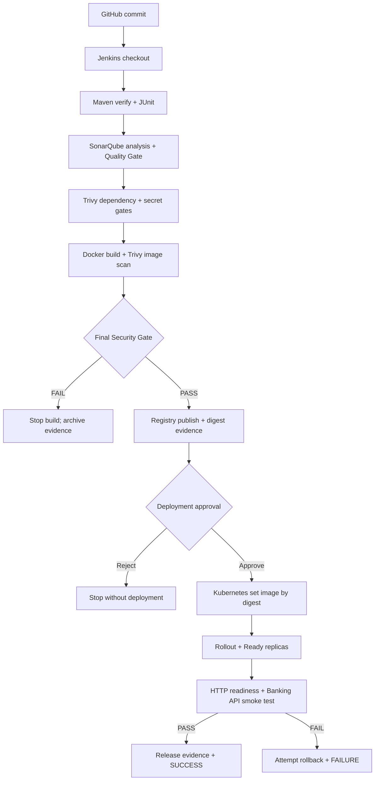

# BANKING CI/CD LAB — Hướng dẫn triển khai từ GitHub đến Kubernetes

> **Phiên bản:** 1.0 · **Ngày tổng hợp:** 12/11/2026  
> **Phạm vi đã thực hành:** CI (Maven/JUnit → SonarQube → Trivy → Docker → Registry) và CD-01.1 → CD-01.6 (Kubernetes deploy, smoke test, rollback, Jenkins automated deployment).  
> **Trạng thái:** Người thực hành xác nhận **CD-01.6 PASS**. Các log được cung cấp trước đó ghi nhận một số build FAIL/UNSTABLE và các mốc PASS trung gian; chưa có Console Output build cuối cùng được đính kèm để độc lập đối chiếu toàn bộ bằng chứng PASS.  
> **Đối tượng:** Developer / DevOps / Tech Lead / Solution Architect — lab Spring Boot theo định hướng Ngân hàng/Fintech.

---

## Mục lục

1. [Mục tiêu và nguyên tắc thiết kế](#1-mục-tiêu-và-nguyên-tắc-thiết-kế)
2. [Kiến trúc tổng thể và inventory](#2-kiến-trúc-tổng-thể-và-inventory)
3. [Chuẩn bị hệ thống và cấu trúc Git](#3-chuẩn-bị-hệ-thống-và-cấu-trúc-git)
4. [CI-01 — Build, Unit Test và SonarQube](#4-ci-01--build-unit-test-và-sonarqube)
5. [CI-02 — Trivy vulnerability/secret gates](#5-ci-02--trivy-vulnerabilitysecret-gates)
6. [TRIVY-05 — Docker image security gate](#6-trivy-05--docker-image-security-gate)
7. [CI-03 — Local Registry và Image Promotion](#7-ci-03--local-registry-và-image-promotion)
8. [CD-01.1 → CD-01.5 — Kubernetes thủ công](#8-cd-011--cd-015--kubernetes-thủ-công)
9. [CD-01.6 — Tự động deploy bằng Jenkins](#9-cd-016--tự-động-deploy-bằng-jenkins)
10. [Jenkinsfile — cấu trúc chuẩn và snippets tích hợp](#10-jenkinsfile--cấu-trúc-chuẩn-và-snippets-tích-hợp)
11. [Troubleshooting — tất cả lỗi chính đã gặp](#11-troubleshooting--tất-cả-lỗi-chính-đã-gặp)
12. [Kiểm thử, nghiệm thu, release evidence](#12-kiểm-thử-nghiệm-thu-release-evidence)
13. [Checklist phục hồi lab và vận hành](#13-checklist-phục-hồi-lab-và-vận-hành)
14. [Rủi ro còn lại và kế hoạch hardening](#14-rủi-ro-còn-lại-và-kế-hoạch-hardening)
15. [Phụ lục lệnh nhanh và glossary](#15-phụ-lục-lệnh-nhanh-và-glossary)

---

## 1. Mục tiêu và nguyên tắc thiết kế

**Bài toán**: xây dựng chuỗi CI/CD để một Spring Boot Banking API từ commit GitHub được build, kiểm thử, kiểm tra chất lượng, scan bảo mật, đóng gói Docker image, publish vào private registry local và triển khai Kubernetes bằng **image digest**.

### 1.1. Các bảo đảm mục tiêu

- **Build reproducibility**: có commit Git, Jenkins build number, artifact và image ID/digest để truy vết.
- **Quality gate**: SonarQube có quyền ngăn pipeline tiếp tục khi không đạt Quality Gate.
- **Dependency/image vulnerability gate**: chặn HIGH và CRITICAL theo chính sách lab.
- **Secret gate**: không cho phép token, mật khẩu, kubeconfig có credential được đi theo source code.
- **Promotion-after-approval**: image được publish **sau** final security gate; deployment **sau** approval.
- **Deploy by digest**: tham chiếu `registry/repository@sha256:...`, không chỉ dựa vào tag dễ đổi.
- **Least privilege**: Jenkins deployer giới hạn trong namespace `banking-dev`.
- **Release safety**: readiness/liveness, rolling update, smoke test, rollback và evidence.

> **Phân biệt quan trọng:** “CI thành công” không có nghĩa “sẵn sàng production”. Lab hiện dùng HTTP registry local, Docker socket trên build agent và token kubeconfig dạng file. Những điểm này phù hợp học tập nhưng cần hardening trước production.

### 1.2. Pipeline logic



---

## 2. Kiến trúc tổng thể và inventory

### 2.1. Hạ tầng đã sử dụng

| Thành phần | Tên/giá trị trong lab | Vai trò |
|---|---|---|
| Host | Windows 11 + Docker Desktop | Chạy containers và Kubernetes local |
| Docker network | **`banking-cicd-net`** | Mạng trao đổi giữa các thành phần CI/CD |
| Jenkins controller | `ci-jenkins-1` | Orchestrate jobs, tools, credentials, reports |
| Jenkins Docker agent | `ci-docker-agent-1` | Docker build, image scan/push, `kubectl` deploy |
| Jenkins agent label | `docker-build` | Stage-level agent allocation |
| Jenkins job | `banking-api-ci` | Pipeline build/deploy |
| SonarQube | `http://host.docker.internal:9000` (từ container theo cấu hình lab) | Static code analysis + Quality Gate |
| Registry container | `ci-registry-1` | Docker Distribution Registry local |
| Registry reference | `localhost:5000/banking-api` | Image push/pull **theo góc nhìn Docker daemon và K8s registry mapping** |
| Kubernetes node | `desktop-control-plane` | Kind node local của Docker Desktop |
| K8s namespace | `banking-dev` | Environment lab |
| K8s Deployment | `banking-api` | 2 replica Spring Boot API |
| K8s Service | `banking-api` | ClusterIP port 8080 |
| K8s ServiceAccount | `jenkins-deployer` | Jenkins deployment identity |
| Jenkins secret file ID | `banking-dev-kubeconfig` | Kubeconfig RBAC-limited, **không commit Git** |
| Spring Boot | 4.1.2 trong các log gần nhất | Application framework |
| Java | 21 | Compile + runtime |
| Maven | 3.10.0 trên controller theo log | Build/test |
| Trivy | 0.76.2 theo log | Vulnerability và secret scanning |
| kubectl (agent log) | v1.31.1 tại một mốc kiểm thử | K8s CLI; cần tương thích API server |

**Git repository**: `https://github.com/thinhhong1973/banking-cicd-lab.git`  
**Branch đã dùng trong lab**: `lab/trivy-04-remediation`  
**API test**: `/api/v1/accounts/ACC-001/balance` (200), `/api/v1/accounts/ACC-999/balance` (404).

> **Không giả định** Docker image của Jenkins agent tên `banking-jenkins-agent:1.0`: trong quá trình triển khai, tên image đó không có trên máy. Xác định image thực tế với `docker inspect` trước khi chỉnh sửa container. Đừng nhầm tên container với tên image.

### 2.2. Docker networking có hai góc nhìn

1. **Docker CLI ở Jenkins agent** nói chuyện với Docker Engine qua `/var/run/docker.sock`. Registry `localhost:5000` trong lệnh `docker push` được Docker **daemon** resolve, không đồng nhất với `localhost` trong agent container.
2. **Kubernetes node** có network namespace và containerd registry resolver riêng. Cần mapping `localhost:5000` → `http://ci-registry-1:5000` ở bên trong **kind node**.
3. `ci-registry-1`, `ci-docker-agent-1`, `desktop-control-plane` cần tham gia các Docker networks phù hợp; network hạ tầng CI thực tế là `banking-cicd-net`. Network `kind` có thể có riêng cho cluster; cần kiểm tra `docker network inspect`, không giả định tên.

### 2.3. Cấu trúc project khuyến nghị

```text
banking-cicd-lab/
├── Jenkinsfile
├── Dockerfile
├── pom.xml
├── src/
│   ├── main/java/.../BankingApplication.java
│   ├── main/java/.../BalanceController.java
│   └── test/java/.../BalanceControllerTest.java
├── k8s/
│   ├── banking-deployment.yaml
│   ├── banking-service.yaml
│   └── jenkins-deployer-rbac.yaml
├── docs/
│   └── banking-cicd-runbook-ci01-cd01.md
└── .gitignore
```

**Tuyệt đối không commit** `jenkins-banking-kubeconfig.yaml`, `.kube/config`, Docker credentials, Jenkins secrets, các token dump hay file chứa mật khẩu.

---

## 3. Chuẩn bị hệ thống và cấu trúc Git

### 3.1. Preflight trên Windows PowerShell

```powershell
git --version
docker version
docker ps
kubectl version --client
kubectl config current-context
kubectl get nodes -o wide

# Các container chính
docker ps --format '{{.Names}}  {{.Image}}  {{.Status}}'

# Mạng CI thực tế
docker network inspect banking-cicd-net `
  --format '{{range .Containers}}{{println .Name}}{{end}}'
```

### 3.2. Kiểm tra Jenkins agent image thực tế

```powershell
docker inspect ci-docker-agent-1 `
  --format 'Image={{.Config.Image}} Status={{.State.Status}}'

docker exec -u jenkins ci-docker-agent-1 sh -c `
  'id; docker version; trivy --version'
```

Nếu `docker exec -u jenkins` không hợp với username thực tế, kiểm tra `docker inspect ... --format '{{.Config.User}}'` hoặc `docker exec ... id`.

### 3.3. `.gitignore`

```gitignore
# Java / Maven
target/

# Credentials / kubeconfig
jenkins-banking-kubeconfig.yaml
*.kubeconfig
.kube/
**/credentials.json

# Local evidence that must not be committed
reports/
*.tar
```

**Cần xem xét** trước khi thêm những pattern rộng như `*.yaml` vì sẽ vô tình loại các Kubernetes manifests cần version control. `*.kubeconfig` chỉ là một lớp phòng ngừa; secret scan vẫn bắt buộc.

---

## 4. CI-01 — Build, Unit Test và SonarQube

### 4.1. Maven và Java

Jenkins controller có Java 21 và Maven, job `banking-api-ci` thực hiện:

```bash
java -version
mvn -version
mvn -B -ntp clean verify
```

Tại log Build #21/#22, `BalanceControllerTest` chạy **2 tests, 0 failures, 0 errors**, và tạo `target/banking-api-0.1.0.jar`.

**Test cases mẫu**:

- `ACC-001` trả về balance thành công (HTTP 200).
- `ACC-999` không tồn tại (HTTP 404).

Unit/integration tests được lưu dưới dạng `target/surefire-reports/*.xml`; Jenkins đọc qua `junit` và publish test result.

### 4.2. SonarQube kết nối Jenkins

**Server configuration** đã dùng: `banking-sonarqube`.

Lệnh Maven scanner phiên bản đã xuất hiện trong log:

```bash
mvn -B -ntp \
  org.sonarsource.scanner.maven:sonar-maven-plugin:5.1.0.4751:sonar \
  -Dsonar.projectKey=banking-api \
  -Dsonar.projectName=banking-api
```

Một Jenkins stage tương ứng:

```groovy
stage('SonarQube Analysis') {
    steps {
        withSonarQubeEnv('banking-sonarqube') {
            sh '''
                set -eu
                mvn -B -ntp \
                  org.sonarsource.scanner.maven:sonar-maven-plugin:5.1.0.4751:sonar \
                  -Dsonar.projectKey=banking-api \
                  -Dsonar.projectName=banking-api
            '''
        }
    }
}

stage('SonarQube Quality Gate') {
    steps {
        timeout(time: 10, unit: 'MINUTES') {
            script {
                def qg = waitForQualityGate()
                if (qg.status != 'OK') {
                    error("SonarQube Quality Gate failed: ${qg.status}")
                }
            }
        }
    }
}
```

> **Lưu ý:** Đoạn trên minh họa chuẩn; job thực tế trước đây còn cấu hình Sonar token. Scanner phải nhận token qua Jenkins Credentials/`withSonarQubeEnv`, không đặt token trong Jenkinsfile hoặc command đã commit. Nếu binding mặc định chưa cung cấp token phù hợp, dùng đúng cơ chế credentials đã kiểm thử trong job hiện tại.

### 4.3. Webhook SonarQube → Jenkins

Jenkins endpoint thường có dạng:

```text
http://ci-jenkins-1:8080/sonarqube-webhook/
```

- Bắt buộc có dấu `/` cuối đường dẫn.
- SonarQube phải truy cập được Jenkins trên network.
- Trong lab đã gặp lỗi SonarQube từ chối HTTP webhook trỏ đến địa chỉ private/local (`Invalid URL: loopback, wildcard, link-local, site-local ...`). Đã xử lý bằng cấu hình cho phép local webhook phù hợp trong SonarQube Community và kiểm tra kết nối.
- **Sonar webhook không tự khởi động Jenkins `Build Now`**. Nhiệm vụ của webhook là thông báo **kết quả phân tích** cho `waitForQualityGate`. Muốn tự kích hoạt build từ Git push, phải cấu hình GitHub webhook/SCM polling hoặc cơ chế Jenkins trigger riêng.

### 4.4. Lỗi SonarQube 401 đã gặp

```text
Failed to query server version ... HTTP 401
Please check sonar.token / SONAR_TOKEN
```

**Nguyên nhân**: Sonar scanner thiếu token hợp lệ hoặc credentials binding không đúng. Kiểm tra server config và credentials, không in token ra console, chạy lại stage. Mốc về sau ghi nhận Quality Gate `OK`.

---

## 5. CI-02 — Trivy vulnerability/secret gates

### 5.1. Mục tiêu

Quét dependency và source tree trước khi dựng container. Khi có HIGH/CRITICAL, ngăn promotion.

### 5.2. Dependency scanning

```bash
mkdir -p reports
trivy fs \
  --scanners vuln \
  --severity HIGH,CRITICAL \
  --format json \
  --exit-code 0 \
  --no-progress \
  --output reports/trivy-vulnerabilities.json \
  .
```

Trong Jenkins, parser đọc `reports/trivy-vulnerabilities.json`, tính số `HIGH` và `CRITICAL`; nếu lớn hơn 0 thì đặt build **UNSTABLE**, sau đó Final Security Gate chủ động chặn publish/deploy. Mô hình “UNSTABLE rồi final FAIL” là lựa chọn thực hành; ở production nên dùng explicit stage failure hoặc policy engine có evidence rõ ràng.

**Mốc remediation thực tế:** phiên bản Spring Boot/dependencies cũ xuất hiện nhiều phát hiện HIGH/CRITICAL; nâng cấp lên **Spring Boot 4.1.2**, log về sau xác nhận **0 HIGH, 0 CRITICAL** cho dependency scan.

### 5.3. Secret scanning

```bash
trivy fs --scanners secret --exit-code 1 --no-progress .
```

**Rất quan trọng:** Trivy report có thể ghi `pom.xml | Secrets: -`, dấu `-` nghĩa là **Not scanned**, KHÔNG đồng nghĩa với 0 findings. Không diễn giải “secret scan toàn bộ source sạch” nếu report chỉ có các mục chưa được quét. Ngược lại, khi kubeconfig bị đưa vào source checkout, Trivy đã phát hiện **JWT token** và trả exit code 1, chứng minh secret gate có hiệu lực với file text đó.

### 5.4. Chặn credential thực sự bị lộ

Một log gần cuối ghi nhận:

```text
jenkins-banking-kubeconfig.yaml (secrets)
MEDIUM: JWT (jwt-token)
jenkins-banking-kubeconfig.yaml:12
token: ********
Finished: FAILURE
```

Cách xử lý đúng:

1. Xem token là **đã bị lộ**, thu hồi/rotate; không bypass bằng `.trivyignore`.
2. Nếu là bound ServiceAccount token, có thể xóa/tạo lại ServiceAccount theo quy trình quản trị để vô hiệu hóa token gắn với UID cũ, rồi cấp token mới. Kiểm tra RoleBinding còn đúng.
3. `git rm --cached --ignore-unmatch jenkins-banking-kubeconfig.yaml` + `.gitignore` + commit mới.
4. **Xử lý Git history** nếu secret từng được push (việc xóa khỏi HEAD không xóa khỏi lịch sử); dùng Git history rewrite có kế hoạch và phối hợp, không force-push tùy tiện.
5. Tạo Jenkins **Secret file** credential mới, không đưa kubeconfig vào repository.

---

## 6. TRIVY-05 — Docker image security gate

### 6.1. Vì sao cần scan image ngoài scan dependency?

Dependency scan ở Maven/`pom.xml` không nhìn hết vulnerabilities của base OS, JRE, `apt`, `libapt-pkg7.0` hay tools trong image. Một JAR sạch chưa chắc Docker image sạch.

### 6.2. Dockerfile đã sử dụng trong lab

```dockerfile
FROM maven:3.9-eclipse-temurin-21 AS builder
WORKDIR /build
COPY pom.xml .
COPY src ./src
RUN mvn -B -ntp clean package -DskipTests

FROM eclipse-temurin:21-jre
WORKDIR /app

RUN apt-get update \
    && DEBIAN_FRONTEND=noninteractive apt-get install -y --no-install-recommends \
       --only-upgrade apt libapt-pkg7.0 \
    && rm -rf /var/lib/apt/lists/*

RUN groupadd --system appgroup \
    && useradd --system --gid appgroup --home-dir /app appuser

COPY --from=builder /build/target/banking-api-0.1.0.jar /app/app.jar
RUN chown appuser:appgroup /app/app.jar
USER appuser
EXPOSE 8080
ENTRYPOINT ["java", "-jar", "/app/app.jar"]
```

**Lưu ý về phiên bản:** Dockerfile trên là **bản đã thấy trong log**, không phải bản tối ưu lâu dài. Việc rebuild JAR trong Dockerfile với `-DskipTests` khác đường build/test Maven bên ngoài là **khoảng trống về artifact parity**. Bước hardening nên `stash/unstash` JAR đã kiểm thử và COPY chính JAR ấy vào runtime image, hoặc thiết lập attestation chứng minh equivalence.

### 6.3. CVE ở Ubuntu base image

- Trivy phát hiện HIGH trong `apt`/`libapt-pkg7.0` của Ubuntu 26.04 ở mốc đầu.
- Cập nhật hai packages bằng `--only-upgrade` trong Dockerfile đã loại findings theo DB tại thời điểm kiểm thử.
- Build #14 và các build CI gần đây có `IMAGE HIGH: 0`, `IMAGE CRITICAL: 0`.
- Đây **không** phải cam kết image luôn 0 CVE: DB và vulnerability feeds thay đổi theo thời gian. Cần scan lại định kỳ.

### 6.4. Jenkins Docker build agent

Jenkins controller không nên là nơi build Docker chính. Lab dùng agent `ci-docker-agent-1`, label `docker-build`, có Docker CLI, Trivy và về sau `kubectl`.

Đã dùng Docker Engine qua:

```text
-v /var/run/docker.sock:/var/run/docker.sock
```

Docker socket có đặc quyền rất cao đối với Docker host. Cấu hình này **chỉ phù hợp lab**; production nên dùng isolated/ephemeral build agent, BuildKit rootless hoặc remote builder được kiểm soát. Agent có thời điểm cần bổ sung group GID 0 để đọc socket trong môi trường này.

### 6.5. Build, save và scan đúng image

```bash
set -eu
IMAGE_TAG="banking-api:ci-${BUILD_NUMBER}"
mkdir -p reports

docker build --pull -t "$IMAGE_TAG" .
docker image inspect --format '{{.Id}}' "$IMAGE_TAG" \
  > reports/docker-image-id.txt

docker save -o banking-api-image.tar "$IMAGE_TAG"
trivy image \
  --input banking-api-image.tar \
  --scanners vuln \
  --severity HIGH,CRITICAL \
  --format json \
  --exit-code 0 \
  --no-progress \
  --output reports/trivy-image.json

rm -f banking-api-image.tar
```

**Tại sao `docker save` → `trivy image --input`?** Đây là giải pháp đã kiểm thử khi môi trường agent và daemon dùng Docker socket và cần scan đúng image được build. Trong Jenkins dùng `post { always { ... } }` để archive report và dọn file tar kể cả khi stage lỗi.

### 6.6. Docker buildx warning

```text
DEPRECATED: The legacy builder is deprecated
Install the buildx component to build images with BuildKit
```

Đây là **warning**, không phải nguyên nhân fail trong log. Cần cài buildx sau, không ưu tiên hơn security gate/registry/deployment.

---

## 7. CI-03 — Local Registry và Image Promotion

### 7.1. Dựng registry local

PowerShell:

```powershell
docker volume create ci_registry_data

docker run -d `
  --name ci-registry-1 `
  --restart unless-stopped `
  -p 127.0.0.1:5000:5000 `
  -v ci_registry_data:/var/lib/registry `
  registry:3

Invoke-RestMethod http://localhost:5000/v2/
Invoke-RestMethod http://localhost:5000/v2/_catalog
```

Nếu container đã tồn tại, không chạy lại `docker run` với cùng tên; kiểm tra `docker ps -a` và `docker start ci-registry-1`. Việc chạy HTTP không authentication là local lab, **không triển khai production** theo cách này.

### 7.2. Manual push/pull để kiểm chứng registry

```powershell
# Thay ci-14 bằng image local có thật
docker image inspect banking-api:ci-14

docker tag banking-api:ci-14 localhost:5000/banking-api:ci-14
docker push localhost:5000/banking-api:ci-14

docker pull localhost:5000/banking-api:ci-14
Invoke-RestMethod http://localhost:5000/v2/banking-api/tags/list
```

### 7.3. Stage Registry Publish: không rebuild

Sau khi **Final Security Gate PASS**:

```bash
set -eu
IMAGE_LOCAL="banking-api:ci-${BUILD_NUMBER}"
IMAGE_REGISTRY="localhost:5000/banking-api:ci-${BUILD_NUMBER}"
mkdir -p reports

docker image inspect "$IMAGE_LOCAL" --format '{{.Id}}' \
  > reports/image-id-before-push.txt

docker tag "$IMAGE_LOCAL" "$IMAGE_REGISTRY"
docker push "$IMAGE_REGISTRY"
docker pull "$IMAGE_REGISTRY"

docker image inspect "$IMAGE_REGISTRY" --format '{{.Id}}' \
  > reports/image-id-after-push.txt
cmp reports/image-id-before-push.txt reports/image-id-after-push.txt
```

> **Cảnh báo concurrency:** Cách làm này giả định Docker build & registry publish chạy trên **cùng Docker Engine**, và không có hai builds cùng lúc dùng chung tag có thể ghi đè. Với nhiều agents phải có cơ chế chuyển artifact, distinct tags và serialization/release locking.

### 7.4. Digest reference đúng định dạng

**Lỗi đã gặp:** `docker image inspect ... --format '{{index .RepoDigests 0}}'` trả `banking-api@sha256:...`, không có tiền tố `localhost:5000/` trong log một build. Phải kiểm chứng và chuẩn hóa trước deploy.

Dùng digest từ output của **chính `docker push`** khi có thể; hoặc chuẩn hóa trường RepoDigests:

```bash
RAW_REF="$(docker image inspect "$IMAGE_REGISTRY" \
  --format '{{index .RepoDigests 0}}')"
case "$RAW_REF" in
  localhost:5000/banking-api@sha256:*) APPROVED_IMAGE="$RAW_REF" ;;
  banking-api@sha256:*) APPROVED_IMAGE="localhost:5000/$RAW_REF" ;;
  *) echo "Unexpected registry digest: $RAW_REF" >&2; exit 1 ;;
esac

printf '%s\n' "$APPROVED_IMAGE" > reports/published-image-digest.txt
```

**Ví dụ thực tế trong build #22** (không xem đây là digest luôn đúng cho các build về sau):

```text
localhost:5000/banking-api@sha256:923aad002e6cec185ef4f5cf96f7ac121f993170a36c67f6c708f7c93beb2e93
```

### 7.5. Chuyển release evidence sang CD stage

```groovy
stash(name: 'approved-image', includes: 'reports/published-image-digest.txt')
```

Trong deploy stage (workspace có thể khác):

```groovy
unstash 'approved-image'
```

Không giả định agent workspace và controller workspace dùng chung filesystem.

---

## 8. CD-01.1 → CD-01.5 — Kubernetes thủ công

### 8.1. CD-01.1 — Khởi tạo Kubernetes

Docker Desktop → Kubernetes → cluster loại kind (tùy phiên bản giao diện).

```powershell
kubectl config get-contexts
kubectl config use-context docker-desktop
kubectl get nodes -o wide
kubectl create namespace banking-dev
```

Nếu namespace đã tồn tại thì dùng `kubectl get namespace banking-dev` thay vì tạo lại.

### 8.2. CD-01.2 — Kubernetes pull local registry

Do kind node không resolve `localhost:5000` về Windows registry, cần mapping containerd đến `ci-registry-1`.

Kiểm tra container node và networks thực tế:

```powershell
docker ps --format '{{.Names}}  {{.Image}}'
docker network ls
docker network inspect banking-cicd-net
```

Kiểm tra `ci-registry-1` và `desktop-control-plane` có thể giao tiếp qua một network chung. Nếu cần cho node tham gia network CI:

```powershell
docker network connect banking-cicd-net desktop-control-plane
```

Lệnh có thể trả lỗi nếu node đã kết nối; không phải tạo network `ci-agent-network` vì **tên đúng của lab là `banking-cicd-net`**.

Tạo resolver tại kind node (PowerShell):

```powershell
$node = 'desktop-control-plane'

$registryConfig = @'
[host."http://ci-registry-1:5000"]
  capabilities = ["pull", "resolve"]
'@

$registryConfig | docker exec -i $node sh -c `
  'mkdir -p /etc/containerd/certs.d/localhost:5000 && cat > /etc/containerd/certs.d/localhost:5000/hosts.toml'

docker exec $node cat /etc/containerd/certs.d/localhost:5000/hosts.toml
```

**Điều kiện:** containerd trong node phải sử dụng `certs.d` hosts directory; trong thực hành đã xác minh bằng log `Successfully pulled image`. Cấu hình đặt thủ công trong node có thể mất khi cluster bị tạo lại. Đối với cluster nhiều nodes, cấu hình **từng node**.

### 8.3. CD-01.3 — Deployment manifest

`k8s/banking-deployment.yaml` (mẫu để dùng lại; `runAsUser` cần đúng UID thực tế trong image):

```yaml
apiVersion: apps/v1
kind: Deployment
metadata:
  name: banking-api
  namespace: banking-dev
  labels:
    app: banking-api
spec:
  replicas: 2
  revisionHistoryLimit: 5
  strategy:
    type: RollingUpdate
    rollingUpdate:
      maxSurge: 1
      maxUnavailable: 0
  selector:
    matchLabels:
      app: banking-api
  template:
    metadata:
      labels:
        app: banking-api
    spec:
      containers:
        - name: banking-api
          image: IMAGE_REFERENCE_PLACEHOLDER
          imagePullPolicy: Always
          ports:
            - name: http
              containerPort: 8080
          env:
            - name: MANAGEMENT_ENDPOINT_HEALTH_PROBES_ENABLED
              value: "true"
          startupProbe:
            httpGet:
              path: /actuator/health/liveness
              port: http
            periodSeconds: 5
            failureThreshold: 24
          readinessProbe:
            httpGet:
              path: /actuator/health/readiness
              port: http
            periodSeconds: 5
            failureThreshold: 3
          livenessProbe:
            httpGet:
              path: /actuator/health/liveness
              port: http
            periodSeconds: 10
            failureThreshold: 3
          resources:
            requests:
              cpu: 100m
              memory: 128Mi
            limits:
              cpu: "1"
              memory: 512Mi
          securityContext:
            runAsNonRoot: true
            # Đặt bằng UID thật của appuser trong image (vd 999)
            runAsUser: 999
            allowPrivilegeEscalation: false
            capabilities:
              drop: ["ALL"]
            seccompProfile:
              type: RuntimeDefault
```

**Cần bổ sung Actuator trong `pom.xml`** và health probes đúng endpoint như đã kiểm thử; nếu không, Kubernetes trả 404 khi probe.

`k8s/banking-service.yaml`:

```yaml
apiVersion: v1
kind: Service
metadata:
  name: banking-api
  namespace: banking-dev
spec:
  type: ClusterIP
  selector:
    app: banking-api
  ports:
    - name: http
      port: 8080
      targetPort: http
      protocol: TCP
```

### 8.4. Lỗi non-root UID và cách giải quyết

**Log ban đầu**:

```text
CreateContainerConfigError
container has runAsNonRoot and image has non-numeric user (appuser),
cannot verify user is non-root
```

Đây là **securityContext verification**, không phải ImagePullBackOff. Image đã pull thành công. Dockerfile khai báo `USER appuser` nhưng Kubernetes cần biết UID dạng số để khẳng định non-root.

Tìm UID thật:

```powershell
docker run --rm --entrypoint id banking-api:ci-14 -u appuser
```

Thêm `runAsUser: <UID_THAT>` vào Deployment. **Đừng dùng 999 nếu UID thực tế khác**. Về lâu dài, Dockerfile nên dùng `USER 10001:10001` với user/group được tạo cố định.

### 8.5. PowerShell `kubectl patch` và JSON escaping

Lỗi đã gặp:

```text
invalid character 's' looking for beginning of object key string
```

Với PowerShell, dùng `--patch-file` thay vì truyền JSON nội tuyến dễ bị sửa dấu nháy:

```powershell
$patch = @{
  spec = @{
    template = @{
      spec = @{
        containers = @(@{
          name = 'banking-api'
          securityContext = @{ runAsUser = 999 }
        })
      }
    }
  }
}

$patch | ConvertTo-Json -Depth 10 |
  Set-Content .\banking-uid-patch.json -Encoding ASCII

kubectl -n banking-dev patch deployment banking-api `
  --type=strategic --patch-file=.\banking-uid-patch.json
```

**Nhớ** chỉnh UID trong ví dụ theo image. Sau khi patch, cập nhật lại manifest Git, tránh lần `kubectl apply` sau ghi đè thay đổi runtime.

### 8.6. Apply image theo digest

Lấy digest đã publish thực tế:

```powershell
$imageRef = 'localhost:5000/banking-api@sha256:<DIGEST_THUC_TE>'

(Get-Content .\k8s\banking-deployment.yaml -Raw).Replace(
  'IMAGE_REFERENCE_PLACEHOLDER', $imageRef
) | kubectl apply -f -

kubectl apply -f .\k8s\banking-service.yaml
kubectl -n banking-dev rollout status deployment/banking-api --timeout=180s
kubectl -n banking-dev get pods -l app=banking-api
```

### 8.7. CD-01.4 — API và image verification

```powershell
# Terminal thứ nhất
kubectl -n banking-dev port-forward service/banking-api 18080:8080

# Terminal thứ hai
Invoke-RestMethod http://localhost:18080/actuator/health/readiness
Invoke-RestMethod http://localhost:18080/actuator/health/liveness
Invoke-RestMethod http://localhost:18080/api/v1/accounts/ACC-001/balance
```

Kiểm tra image reference trong Deployment:

```powershell
kubectl -n banking-dev get deployment banking-api `
  -o custom-columns='NAME:.metadata.name,IMAGE:.spec.template.spec.containers[0].image'
```

Kiểm tra image ID các pods:

```powershell
kubectl -n banking-dev get pods -l app=banking-api `
  -o custom-columns='POD:.metadata.name,IMAGE_ID:.status.containerStatuses[0].imageID'
```

Lỗi PowerShell đã gặp với JSONPath có dấu nháy kép:

```text
error: name cannot be provided when a selector is specified
```

Dùng `custom-columns` hoặc `-o yaml` cho truy vấn này; tránh JSONPath phức tạp qua PowerShell nếu không cần thiết.

### 8.8. CD-01.5 — Rolling update và rollback

```powershell
kubectl -n banking-dev rollout history deployment/banking-api

# Khi có image mới ĐÃ QUA GATE
$newImage = 'localhost:5000/banking-api@sha256:<NEW_APPROVED_DIGEST>'
kubectl -n banking-dev set image deployment/banking-api "banking-api=$newImage"
kubectl -n banking-dev rollout status deployment/banking-api --timeout=180s

# Khi cần revert
kubectl -n banking-dev rollout undo deployment/banking-api
kubectl -n banking-dev rollout status deployment/banking-api --timeout=180s
```

**Điều kiện:** rollback theo revision chỉ có ý nghĩa khi đã có ít nhất hai revisions. Smoke test sau rollback để chứng minh service hoạt động.

---

## 9. CD-01.6 — Tự động deploy bằng Jenkins

### 9.1. Mô hình quyền

Sử dụng ServiceAccount `jenkins-deployer`, Role/RoleBinding trong `banking-dev`. **Không dùng kubeconfig cluster-admin** đưa vào Jenkins. Jenkins chỉ cần quyền đọc/giám sát và patch/update đúng Deployment.

`k8s/jenkins-deployer-rbac.yaml`:

```yaml
apiVersion: v1
kind: ServiceAccount
metadata:
  name: jenkins-deployer
  namespace: banking-dev
automountServiceAccountToken: false
---
apiVersion: rbac.authorization.k8s.io/v1
kind: Role
metadata:
  name: jenkins-deployer
  namespace: banking-dev
rules:
  - apiGroups: ["apps"]
    resources: ["deployments"]
    resourceNames: ["banking-api"]
    verbs: ["get", "patch", "update", "watch"]
  - apiGroups: ["apps"]
    resources: ["deployments"]
    verbs: ["list"]
  - apiGroups: ["apps"]
    resources: ["replicasets"]
    verbs: ["get", "list", "watch"]
  - apiGroups: [""]
    resources: ["pods"]
    verbs: ["get", "list", "watch"]
  - apiGroups: [""]
    resources: ["pods/portforward"]
    verbs: ["create"]
  - apiGroups: [""]
    resources: ["services"]
    resourceNames: ["banking-api"]
    verbs: ["get"]
---
apiVersion: rbac.authorization.k8s.io/v1
kind: RoleBinding
metadata:
  name: jenkins-deployer
  namespace: banking-dev
subjects:
  - kind: ServiceAccount
    name: jenkins-deployer
    namespace: banking-dev
roleRef:
  kind: Role
  name: jenkins-deployer
  apiGroup: rbac.authorization.k8s.io
```

Apply/verify từ Windows admin context:

```powershell
kubectl apply -f .\k8s\jenkins-deployer-rbac.yaml

$sa = 'system:serviceaccount:banking-dev:jenkins-deployer'
kubectl auth can-i list deployments -n banking-dev --as=$sa
kubectl auth can-i patch deployment/banking-api -n banking-dev --as=$sa
kubectl auth can-i delete deployments -n banking-dev --as=$sa
```

Kỳ vọng `yes`, `yes`, `no`. Thực tế phát hiện `kubectl rollout status` còn cần `list deployments`; quyền chỉ có `watch/get` theo `resourceNames` không đủ cho client informer mặc định.

### 9.2. Jenkins agent chạy `kubectl` qua volume

Trong lab, không có Docker image giả định `banking-jenkins-agent:1.0`. Đã lựa chọn cài binary `kubectl` vào volume agent để giữ nguyên container đang hoạt động:

```text
/home/jenkins/agent/bin/kubectl
```

Kiểm tra:

```powershell
docker exec -u jenkins ci-docker-agent-1 `
  /home/jenkins/agent/bin/kubectl version --client
```

Có thể download binary Linux tương ứng với architecture và compatible API server version, **xác minh checksum trước khi copy**. Về sau nên bake kubectl vào immutable agent image để quản trị phiên bản tốt hơn.

### 9.3. PATH trong Jenkins Declarative Pipeline

**Lỗi đã gặp**:

```text
(PATH + KUBECTL) is a binary expression,
but it should be a variable expression
```

Do viết sai:

```groovy
// SAI trong Declarative environment { }
environment { PATH+KUBECTL = '/home/jenkins/agent/bin' }
```

**Cách đã sử dụng**:

```groovy
withEnv(['PATH+KUBECTL=/home/jenkins/agent/bin']) {
    sh 'command -v kubectl && kubectl version --client'
}
```

### 9.4. Kết nối Kubernetes API qua Docker network

Network đúng: `banking-cicd-net`.

```powershell
docker network inspect banking-cicd-net `
  --format '{{range .Containers}}{{println .Name}}{{end}}'

# Nếu node chưa nằm trong network
docker network connect banking-cicd-net desktop-control-plane

# Chỉ kiểm tra TCP, chưa kiểm tra TLS/auth
docker run --rm --network banking-cicd-net alpine:3.21 `
  sh -c 'nc -zvw3 desktop-control-plane 6443'
```

Kubeconfig của Jenkins dùng hostname có thể reach được trong mạng này. CA và certificate TLS SAN phải hợp lệ; **không dùng `insecure-skip-tls-verify` như workaround**.

### 9.5. Tạo, lưu, xoay vòng kubeconfig credential

1. Tạo ServiceAccount và RBAC trước.
2. Từ máy admin, tạo short-lived token bằng `kubectl -n banking-dev create token jenkins-deployer --duration=8h` (thời hạn thực tế do API server quy định).
3. Tạo kubeconfig chỉ chứa cluster CA, API server endpoint, `banking-dev` context và **token của `jenkins-deployer`**. Không dùng admin context.
4. Jenkins → **Manage Jenkins → Credentials → Global credentials → Add Credentials → Kind: Secret file**. ID: `banking-dev-kubeconfig`.
5. Test bằng `withCredentials([file(credentialsId: 'banking-dev-kubeconfig', variable: 'KUBECONFIG')])`.
6. Xóa kubeconfig/token local sau khi upload và không đưa vào Git.
7. Khi token hết hạn, phải rotate credential hoặc cải tiến để cấp ngắn hạn động.

Mẫu **không chứa token thực**:

```yaml
apiVersion: v1
kind: Config
clusters:
  - name: banking-local
    cluster:
      server: https://desktop-control-plane:6443
      certificate-authority-data: <CA_BASE64>
      # tls-server-name chỉ dùng khi khớp SAN của certificate
users:
  - name: jenkins-deployer
    user:
      token: <SHORT_LIVED_TOKEN_FROM_KUBECTL_CREATE_TOKEN>
contexts:
  - name: banking-dev
    context:
      cluster: banking-local
      user: jenkins-deployer
      namespace: banking-dev
current-context: banking-dev
```

**Tuyệt đối không commit mẫu đã điền token thật**. Sử dụng `withCredentials`, không hardcode kubeconfig trong Jenkinsfile.

### 9.6. Manual approval

```groovy
stage('Deployment Approval') {
    steps {
        timeout(time: 10, unit: 'MINUTES') {
            input message: 'Deploy approved Banking API to banking-dev?',
                  ok: 'Approve Deployment'
        }
    }
}
```

`input` dừng build để người có thẩm quyền xác nhận. Với production thêm `submitter`, release ticket và change approval policy.

### 9.7. Deploy by digest + RBAC preflight + smoke tests

Một **khung tích hợp** (không copy đè Jenkinsfile đang PASS nếu chưa đối chiếu các plugin, credentials và stages đang có):

```groovy
stage('Kubernetes Deploy & Smoke Test') {
    agent { label 'docker-build' }
    steps {
        withEnv(['PATH+KUBECTL=/home/jenkins/agent/bin']) {
            unstash 'approved-image'
            withCredentials([
                file(credentialsId: 'banking-dev-kubeconfig', variable: 'KUBECONFIG')
            ]) {
                sh '''
                    set -eu
                    set +x
                    NS=banking-dev
                    DEPLOY=banking-api
                    NEW_IMAGE="$(cat reports/published-image-digest.txt)"

                    case "$NEW_IMAGE" in
                      localhost:5000/banking-api@sha256:*) ;;
                      *) echo 'Invalid approved digest reference' >&2; exit 1 ;;
                    esac

                    # Authorization preflight BEFORE mutation
                    test "$(kubectl -n "$NS" auth can-i get deployment/$DEPLOY)" = yes
                    test "$(kubectl -n "$NS" auth can-i patch deployment/$DEPLOY)" = yes
                    test "$(kubectl -n "$NS" auth can-i list deployments)" = yes
                    test "$(kubectl -n "$NS" auth can-i create pods/portforward)" = yes

                    OLD_IMAGE="$(kubectl -n "$NS" get deployment "$DEPLOY" \
                      -o jsonpath='{.spec.template.spec.containers[0].image}')"
                    mkdir -p reports
                    printf '%s\\n' "$OLD_IMAGE" > reports/previous-image.txt
                    printf '%s\\n' "$NEW_IMAGE" > reports/deployed-image.txt

                    if [ "$OLD_IMAGE" != "$NEW_IMAGE" ]; then
                      kubectl -n "$NS" set image deployment/$DEPLOY \
                        banking-api="$NEW_IMAGE"
                    fi

                    kubectl -n "$NS" rollout status deployment/$DEPLOY --timeout=180s
                    test "$(kubectl -n "$NS" get deployment "$DEPLOY" \
                      -o jsonpath='{.status.readyReplicas}')" = 2

                    ACTUAL="$(kubectl -n "$NS" get deployment "$DEPLOY" \
                      -o jsonpath='{.spec.template.spec.containers[0].image}')"
                    test "$ACTUAL" = "$NEW_IMAGE"

                    kubectl -n "$NS" get deployment "$DEPLOY" \
                      -o yaml > reports/deployment-evidence.yaml
                    echo 'ROLLOUT AND DIGEST VERIFIED'
                '''
            }
        }
    }
}
```

**Smoke tests riêng** (chạy khi vẫn còn `withCredentials` và agent có `curl`, với `port-forward` chạy tại cùng agent):

```bash
set -eu
mkdir -p reports
kubectl -n banking-dev port-forward service/banking-api 18080:8080 \
  > reports/port-forward.log 2>&1 &
PF_PID=$!
trap 'kill "$PF_PID" 2>/dev/null || true' EXIT

READY=0
for i in $(seq 1 30); do
  if curl -fsS http://127.0.0.1:18080/actuator/health/readiness \
       > reports/readiness.json 2>/dev/null; then
    READY=1
    break
  fi
  sleep 2
done
test "$READY" -eq 1
grep -q '"status":"UP"' reports/readiness.json

curl -fsS http://127.0.0.1:18080/api/v1/accounts/ACC-001/balance \
  > reports/balance-smoke.json
grep -q 'VND' reports/balance-smoke.json

echo 'REST SMOKE TEST PASSED'
```

**Quan trọng về rollback tự động**:

- Trước khi `set image`, lưu `OLD_IMAGE`.
- Khi rollout hoặc smoke test thất bại **sau khi đã mutation**, gọi `kubectl set image ... banking-api="$OLD_IMAGE"`, sau đó theo dõi rollback và kiểm thử lại.
- Xử lý shell traps cẩn thận: tắt `trap EXIT` trong handler trước khi gọi `exit` để tránh đệ quy. Không coi `ROLLBACK ATTEMPTED` là `ROLLBACK SUCCESS` khi status chưa xác minh.
- Nếu `NEW_IMAGE == OLD_IMAGE`, không tạo revision mới và không rollback giả.
- Không cho nhiều Jenkins jobs deploy cùng Deployment đồng thời (locking/serialization).

### 9.8. Archive evidence

```groovy
post {
    always {
        archiveArtifacts(
            artifacts: 'reports/deploy-result.txt,reports/previous-image.txt,' +
                       'reports/deployed-image.txt,reports/deployment-evidence.yaml,' +
                       'reports/ready-replicas.txt,reports/readiness.json,' +
                       'reports/balance-smoke.json,reports/port-forward.log',
            allowEmptyArchive: true,
            fingerprint: true
        )
    }
}
```

Khi stage chạy trên agent khác, đảm bảo archive được thực hiện trong workspace stage ấy. Không lưu kubeconfig hay token trong artifacts/log.

---

## 10. Jenkinsfile — cấu trúc chuẩn và snippets tích hợp

Đây là **bản thiết kế tổng hợp theo các stages đã thực hiện**, không phải bản sao nguyên văn Jenkinsfile trên GitHub. Vì chưa có file Jenkinsfile cuối cùng được đính kèm, các snippets ở mục trên cần merge vào Jenkinsfile thực tế đang PASS, không thay thế toàn bộ một cách mù quáng.

```groovy
pipeline {
    agent { label 'built-in' }

    options {
        timestamps()
        timeout(time: 30, unit: 'MINUTES')
        disableConcurrentBuilds()
    }

    stages {
        stage('Checkout') { /* checkout scm */ }
        stage('Tool Preflight') { /* Java, Maven, Trivy */ }
        stage('Compile & Unit Tests') { /* mvn clean verify */ }
        stage('SonarQube Analysis') { /* withSonarQubeEnv + Maven scanner */ }
        stage('SonarQube Quality Gate') { /* waitForQualityGate */ }
        stage('Trivy Vulnerability Gate') { /* JSON scan + severity counts */ }
        stage('Trivy Secret Gate') { /* trivy fs --scanners secret --exit-code 1 */ }
        stage('Docker Image Security Gate') { /* agent docker-build; build + scan */ }
        stage('Artifact Evidence') { /* checksum + archive */ }
        stage('Final Security Gate') { /* block UNSTABLE/FAILURE */ }
        stage('Registry Publish') { /* tag + push + digest + stash */ }
        stage('Deployment Approval') { /* input with timeout */ }
        stage('Kubernetes Deploy & Smoke Test') { /* RBAC + digest + rollback */ }
    }

    post {
        always {
            junit allowEmptyResults: true,
                  testResults: 'target/surefire-reports/*.xml'
            archiveArtifacts artifacts: 'reports/*', allowEmptyArchive: true
        }
    }
}
```

### 10.1. Vì sao thứ tự stage quan trọng?

1. **Test và policy gates trước promotion**: code chưa đạt chuẩn không vào Registry trusted.
2. **Image scan sau Docker build**: phát hiện lỗ hổng OS/runtime chứ không chỉ Maven.
3. **Registry digest sau push**: lấy định danh chính xác đã publish.
4. **Approval trước cluster mutation**: tách trách nhiệm CI và CD.
5. **RBAC preflight trước `set image`**: tránh trường hợp đã đổi image nhưng không có quyền theo dõi rollout.
6. **Smoke test sau rollout**: bảo đảm hành vi nghiệp vụ, không chỉ Pod Running.

### 10.2. Kiểm tra điều kiện `when` và Groovy

`when { expression { currentBuild.currentResult == 'SUCCESS' } }` có ích nhưng **không đủ một mình** để chứng minh image được phê duyệt; nên có release metadata/attestation từ scan stage. Đối với shell trong Jenkinsfile, ưu tiên `sh ''' ... '''` để tránh Groovy interpolate secret. Với PowerShell local, ưu tiên `--patch-file` và `custom-columns` thay JSON inline phức tạp.

---

## 11. Troubleshooting — tất cả lỗi chính đã gặp

| # | Triệu chứng | Nguyên nhân | Cách khắc phục / bài học |
|---|---|---|---|
| 01 | SonarQube Scanner HTTP 401 | Token/credentials sai hoặc thiếu | Kiểm tra Jenkins credentials và `withSonarQubeEnv`; không hardcode token |
| 02 | SonarQube webhook `Invalid URL: loopback ...` | SonarQube bảo vệ URL nội bộ/private | Cấu hình cho phép local webhook đúng môi trường và xác minh connectivity |
| 03 | `Build Now` không tự trigger bởi Sonar webhook | Nhầm Sonar webhook với GitHub trigger | Sonar webhook phục vụ `waitForQualityGate`; cần trigger SCM riêng |
| 04 | Trivy HIGH/CRITICAL ở Maven dependencies | Phiên bản Spring Boot/dependency cũ | Remediate/upgrade; scan lại đến khi 0 HIGH/CRITICAL |
| 05 | Docker image HIGH ở Ubuntu apt packages | OS layer có CVE, dù Java deps sạch | Upgrade package/base image; **scan image** |
| 06 | Jenkins agent không khởi động/kết nối | Inbound agent WebSocket/secret/network/permissions | Xác minh container logs, Jenkins secret, URL và `banking-cicd-net`; tránh suy đoán image tag |
| 07 | Docker socket permission denied | Agent user không đủ quyền đọc socket | Xác minh socket GID, group mapping; chỉ dùng docker.sock trong lab |
| 08 | Docker legacy builder warning | Thiếu Docker buildx plugin | Không phải lỗi gate; chuẩn hóa BuildKit/buildx sau |
| 09 | Registry digest thiếu `localhost:5000/` | `.RepoDigests[0]` hiển thị tên rút gọn | Chuẩn hóa/kiểm tra `repository@sha256` trước stash/deploy |
| 10 | `ImagePullBackOff`/HTTP HTTPS mismatch | Kubernetes resolver không trỏ tới HTTP registry | Kind/containerd `certs.d/localhost:5000/hosts.toml`, Docker networking |
| 11 | `CreateContainerConfigError` non-numeric user | Dockerfile `USER appuser` nhưng K8s `runAsNonRoot: true` | Kiểm tra UID thật, thêm `runAsUser`, lâu dài numeric UID trong Dockerfile |
| 12 | `kubectl patch`: `invalid character 's'` | JSON escaping giữa PowerShell và native executable | Dùng `ConvertTo-Json` ra file và `--patch-file` |
| 13 | `kubectl get pods -o jsonpath`: `name cannot be provided when a selector is specified` | Dấu nháy trong PowerShell làm hỏng argv | Dùng `-o custom-columns=...` hoặc YAML |
| 14 | Jenkins Groovy `(PATH + KUBECTL) is a binary expression` | `PATH+KUBECTL` không phải Groovy bare identifier | `withEnv(['PATH+KUBECTL=/home/jenkins/agent/bin'])` |
| 15 | `Could not find credentials entry with ID banking-dev-kubeconfig` | Chưa tạo/ID/scope Secret file sai | Jenkins → Credentials → Secret file, đúng ID |
| 16 | `kubectl rollout status` forbidden `cannot list deployments` | RBAC thiếu `list` cho deployments | Bổ sung Role `list` trong namespace; RBAC preflight trước mutation |
| 17 | Trivy phát hiện JWT trong kubeconfig | Kubeconfig chứa token bị commit/checkout | Revoke/rotate, remove from Git + history, store only Jenkins Credentials |
| 18 | Rollout lỗi sau `set image` | API mutation thành công trước khi monitor thất bại | Theo dõi trạng thái cluster thực tế và xác minh rollback; không nhầm Jenkins FAIL với deploy chưa xảy ra |
| 19 | `kubectl` không tồn tại trên agent | Agent đang chạy không có Kubernetes CLI | Cài binary vào volume hoặc rebuild image agent đã xác minh tên thực |
| 20 | Smoke test 404 tại `/actuator/health/...` | Chưa có Actuator hoặc health probe config | Bổ sung actuator, bật health probes, xác minh bằng `port-forward` |

### 11.1. Cây quyết định debug Kubernetes

```text
kubectl get pods
    |
    +-- ImagePullBackOff -> check image digest + registry mapping + DNS + HTTP/TLS
    |
    +-- CreateContainerConfigError -> kubectl describe pod; check securityContext/UID
    |
    +-- CrashLoopBackOff -> kubectl logs --previous; JVM/config/resources
    |
    +-- Running but 0/1 Ready -> readiness probe, Actuator, port 8080
    |
    +-- 2/2 Ready but API fails -> Service selector, port-forward, API path
    |
    +-- Jenkins cannot monitor -> RBAC list/watch + kubeconfig expiry
```

### 11.2. Một số lệnh debug có giá trị nhất

```powershell
kubectl -n banking-dev get deployments,replicasets,pods,services -o wide
kubectl -n banking-dev describe pods -l app=banking-api
kubectl -n banking-dev logs deployment/banking-api --tail=100
kubectl -n banking-dev rollout history deployment/banking-api
kubectl -n banking-dev get events --sort-by=.metadata.creationTimestamp

# Registry status từ Windows
Invoke-RestMethod http://localhost:5000/v2/_catalog
Invoke-RestMethod http://localhost:5000/v2/banking-api/tags/list

# Xác định image thực tế của Jenkins agent
docker inspect ci-docker-agent-1 --format '{{.Config.Image}}'
```

---

## 12. Kiểm thử, nghiệm thu, release evidence

### 12.1. Ma trận acceptance end-to-end

| Stage/checkpoint | Điều kiện nghiệm thu | Trạng thái theo lịch sử lab |
|---|---|---|
| Maven/JUnit | `mvn verify` success, 2/2 tests | PASS trong nhiều log |
| SonarQube | Analysis success và Quality Gate `OK` | PASS trong nhiều log |
| Trivy dependency | HIGH=0, CRITICAL=0 theo DB lúc scan | PASS sau remediation |
| Trivy secret | Không có secrets được phát hiện trong phạm vi đã quét | Đã PASS ở các mốc, đồng thời chặn token leak thành công ở mốc FAIL |
| Docker image scan | HIGH=0, CRITICAL=0 | PASS, ví dụ Build #14/#21/#22 |
| Final Security Gate | Chỉ PASS nếu mọi gate yêu cầu đạt | PASS ở các build CI có log |
| Registry Publish | `docker push`/`pull`, digest được ghi | PASS ở Build #21/#22 |
| Manual Deployment Approval | Được phê duyệt trước mutation | Đã kiểm thử |
| Kubernetes authentication | Jenkins credential nhận dạng `jenkins-deployer` | PASS sau sửa credentials |
| Kubernetes RBAC | `get/patch/list`, không có quyền delete deployments | Đã sửa và người thực hành xác nhận CD-01.6 PASS |
| Kubernetes Deployment | 2/2 replicas Ready | Người thực hành xác nhận CD-01.1–01.5 PASS |
| REST smoke | Actuator UP, balance inquiry 200 | Người thực hành xác nhận CD-01.6 PASS |
| Rollback | Restore previous approved image và smoke test | Người thực hành xác nhận CD-01.1–01.5 PASS; fault injection tự động nên kiểm thử thêm |
| Jenkins CD-01.6 | Pipeline end-to-end | **Người thực hành xác nhận PASS** |

### 12.2. Bằng chứng nên archive mỗi lần release

```text
reports/
├── trivy-vulnerabilities.json
├── trivy-image.json
├── docker-image-id.txt
├── image-id-before-push.txt
├── image-id-after-push.txt
├── published-image-digest.txt
├── previous-image.txt
├── deployed-image.txt
├── deployment-evidence.yaml
├── ready-replicas.txt
├── readiness.json
├── balance-smoke.json
├── port-forward.log
└── deploy-result.txt
```

Thực tế reports chia ở nhiều agent workspaces; stage nào tạo file thì archive ngay tại workspace đó hoặc stash/unstash đúng cách. **Không archive bất kỳ credential nào**. Có thể bổ sung `commit-sha.txt`, `build-number.txt`, `sonarqube-task-id.txt`, `deployment-approval.txt`, `release-manifest.json` trong vòng cải tiến tiếp theo.

### 12.3. Release provenance chain (Chuỗi nguồn gốc bản phát hành)

```text
Git commit SHA
   -> Jenkins build #
   -> Maven JAR SHA256 (tested)
   -> Docker image ID (built/scanned)
   -> Registry digest (published)
   -> Kubernetes Deployment image reference
   -> Running Pods + readiness + API smoke evidence
```

**Hiện chưa chứng minh đầy đủ JAR equivalence** do Dockerfile còn rebuild JAR. Đây là một trong các việc ưu tiên CD-02; không nên tuyên bố đạt end-to-end supply chain attestation (xác nhận chuỗi cung ứng toàn diện) cho tới khi đã giải quyết.

---

## 13. Checklist phục hồi lab và vận hành

### 13.1. Sau khi khởi động lại Windows/Docker Desktop

- [ ] Docker Desktop đang chạy, Docker Engine healthy.
- [ ] `ci-jenkins-1`, `ci-docker-agent-1`, SonarQube và `ci-registry-1` đều Running.
- [ ] Docker network `banking-cicd-net` vẫn tồn tại và đúng các containers tham gia.
- [ ] Kubernetes `desktop-control-plane` Ready; `banking-dev` tồn tại.
- [ ] Registry `/v2/` truy cập được; volume `ci_registry_data` còn dữ liệu.
- [ ] Kubernetes kind node vẫn resolve `localhost:5000` qua `ci-registry-1` (config có thể mất khi cluster recreate).
- [ ] Jenkins agent connected, `kubectl`, `trivy`, Docker CLI sẵn sàng.
- [ ] Jenkins kubeconfig Secret file token **chưa hết hạn**; không lưu token trong Git.
- [ ] `kubectl -n banking-dev get pods` đạt 2/2 Ready.
- [ ] Có thể `port-forward` và gọi Balance API.

### 13.2. Trước một release mới

- [ ] Source commit đã review, Dockerfile/manifest đúng nhánh.
- [ ] Jenkins Unit Tests, Sonar Quality Gate, dependency/secret/image gates PASS.
- [ ] Release digest trùng image đã scan.
- [ ] Credential token còn hiệu lực, RBAC preflight `yes`.
- [ ] Có approval và previous image reference để rollback.
- [ ] Không có deployment concurrency/race.
- [ ] Rollout + 2/2 Ready + readiness + balance smoke PASS.
- [ ] Reports được archive và có thể tra cứu từ Jenkins build.

### 13.3. Kiểm tra lỗi nóng (PowerShell)

```powershell
# Control plane & workloads
kubectl get nodes
kubectl -n banking-dev get deploy,po,svc

# Registry
Invoke-RestMethod http://localhost:5000/v2/

# CI/CD components
docker ps --filter name=ci-jenkins-1
docker ps --filter name=ci-docker-agent-1
docker ps --filter name=ci-registry-1

# Port-forward nếu cần test thủ công
kubectl -n banking-dev port-forward svc/banking-api 18080:8080
```

---

## 14. Rủi ro còn lại và kế hoạch hardening

| Ưu tiên | Hạng mục | Lý do / hành động tiếp theo |
|---|---|---|
| **P0** | Credential hygiene & rotation | Đã có một JWT lọt vào Git checkout; thu hồi token cũ, scrub lịch sử nếu đã push, dùng short-lived credentials được xoay vòng |
| **P0** | Image/artifact parity | Đổi Dockerfile để COPY đúng Maven JAR đã kiểm thử hoặc thiết lập evidence xác minh artifact equivalence |
| **P0** | Không dùng HTTP registry cho production | TLS, authentication, hardened registry (Harbor/GHCR/private OCI) |
| **P0** | Không dùng Docker socket privileged trên deploy agent | Phân tách build/deploy agents, isolated build runtime, hạn chế host control |
| **P1** | Automated rollback test | Fault injection để xác minh rollback tự động thực sự khôi phục healthy release, thay vì chỉ gọi lệnh |
| **P1** | Concurrent deploy prevention | `disableConcurrentBuilds()` hoặc release lock theo namespace+deployment |
| **P1** | Security policy fail-closed | Kiểm soát publisher chính xác theo scanned digest, scan result và provenance |
| **P1** | Docker buildx / BuildKit | Tránh legacy builder, cache và supply-chain metadata tốt hơn |
| **P1** | Explicit stable numeric UID | `USER 10001:10001`, `runAsUser/runAsGroup` đồng bộ, giảm lỗi kubelet |
| **P1** | SBOM + image signing | CycloneDX/SPDX, Cosign, verify signature/provenance trước deploy |
| **P1** | Kubernetes policy | Pod Security Standards, Kyverno/OPA Gatekeeper, admission policy |
| **P2** | JaCoCo coverage | Log Sonar ghi chưa có JaCoCo report; phát sinh XML coverage và quality criteria |
| **P2** | Registry retention | Garbage collection, retention/immutability, cleanup tag/digest |
| **P2** | Observability | Spring Boot metrics, Prometheus, Grafana, central logs, deployment events |
| **P2** | CD promotion | Dev → Staging → Production, approvals, change management, rollback policy |
| **P2** | DR & recovery | Backup Jenkins home, Jenkins config, registry data và manifests/policies |

### 14.1. Khuyến nghị kế tiếp: CD-02 — Release Hardening

Đề xuất chia thành các workstreams:

1. **CD-02.1 Artifact Parity & Supply Chain**: `mvn verify` → JAR checksum → immutable Docker image; CI metadata.
2. **CD-02.2 Image Identity**: tags commit SHA, digest enforcement, registry trust.
3. **CD-02.3 SBOM & Signing**: SBOM generation, Cosign signing, verification.
4. **CD-02.4 Policy & Deployment Safety**: admission policy, minimum privileges, forced negative tests.
5. **CD-02.5 CD Reliability**: automated rollback verification, deployment serialization, observability.

---

## 15. Phụ lục lệnh nhanh và glossary

### 15.1. PowerShell command sheet

```powershell
# Git
git status --short
git branch --show-current
git log -1 --oneline

# Docker network/agent/registry
docker network inspect banking-cicd-net
docker inspect ci-docker-agent-1 --format '{{.Config.Image}}'
docker logs --tail 100 ci-docker-agent-1
docker logs --tail 100 ci-registry-1
Invoke-RestMethod http://localhost:5000/v2/_catalog

# Kubernetes
kubectl get nodes -o wide
kubectl -n banking-dev get deployment banking-api
kubectl -n banking-dev get pods -l app=banking-api
kubectl -n banking-dev get events --sort-by=.metadata.creationTimestamp
kubectl -n banking-dev rollout status deployment/banking-api --timeout=180s
kubectl -n banking-dev rollout history deployment/banking-api
kubectl -n banking-dev describe pods -l app=banking-api
kubectl -n banking-dev logs deployment/banking-api --tail=100

# Deployer RBAC
$sa='system:serviceaccount:banking-dev:jenkins-deployer'
kubectl auth can-i list deployments -n banking-dev --as=$sa
kubectl auth can-i patch deployment/banking-api -n banking-dev --as=$sa
kubectl auth can-i delete deployments -n banking-dev --as=$sa

# Security of Git index
git ls-files | Select-String 'kubeconfig|credential|secret'
```

### 15.2. Thuật ngữ

| Thuật ngữ | Ý nghĩa |
|---|---|
| **CI** | Continuous Integration: build, test, scan và quality gates |
| **CD** | Continuous Delivery/Deployment: promote và deploy bản đã qua kiểm tra |
| **Quality Gate** | Điều kiện chấp thuận/loại build dựa trên chất lượng mã |
| **CVE** | Định danh lỗ hổng bảo mật được công bố |
| **Image digest** | SHA256 định danh OCI/Docker image manifest trong registry |
| **Image ID** | Định danh image local; không luôn giống registry manifest digest |
| **RBAC** | Role-Based Access Control trong Kubernetes |
| **ServiceAccount** | Identity cho workloads/automation trong Kubernetes |
| **Readiness** | Container/Pod đã đủ điều kiện nhận traffic |
| **Liveness** | Xác định process cần được restart hay không |
| **Rolling Update** | Cập nhật replicas tuần tự và có kiểm soát availability |
| **Rollback** | Phục hồi một bản image/revision trước đó |
| **`stash/unstash`** | Jenkins chuyển files giữa stage/workspace/agent trong cùng build |
| **`withCredentials`** | Jenkins binding secrets vào scope tạm thời |
| **SBOM** | Software Bill of Materials — danh mục thành phần phần mềm |
| **Provenance** | Bằng chứng nguồn gốc, quá trình build, scan, phân phối artifact |

---

## Tổng kết hành trình

**Chúng ta đã biến một Spring Boot API thành một pipeline triển khai có kiểm soát:**

```text
GitHub
  → Jenkins Maven/JUnit
  → SonarQube Quality Gate
  → Trivy Dependency & Secret Gates
  → Docker Image Build & Image CVE Gate
  → Final Security Gate
  → Local Registry (Digest)
  → Deployment Approval
  → Kubernetes RBAC-limited Deploy
  → 2 Ready Pods + Health Probes + Banking REST Smoke
  → Release Evidence + Rollback
```

Những lần build thất bại là **evidence kỹ thuật** quan trọng: Sonar auth sai, local webhook bị từ chối, CVE OS/dependencies, Docker agent, PowerShell JSON quoting, non-numeric UID, Jenkins PATH Groovy syntax, thiếu Jenkins credentials, thiếu RBAC `list deployments`, và cuối cùng là JWT rơi vào Git. Cách xử lý đã củng cố các nguyên tắc nền tảng: **fail closed, least privilege, immutable image identity, secrets outside source, and verifiable deployment**.

**Trạng thái cuối tài liệu:** CD-01.6 **PASS theo xác nhận của người thực hành**. Bước kế tiếp đề xuất: **CD-02 Release Hardening**.

